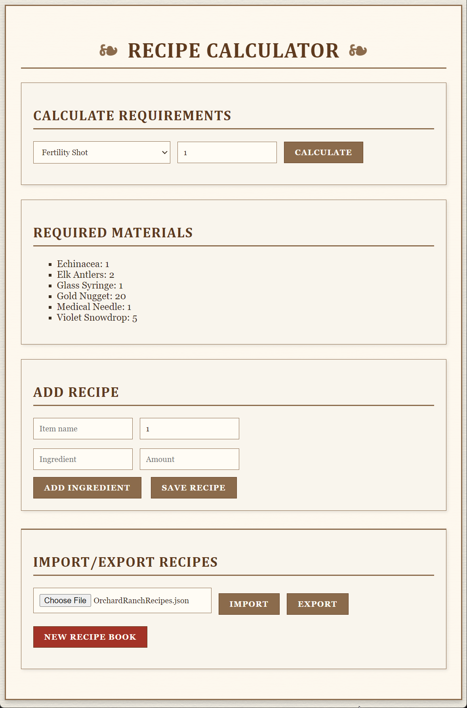

## Crafting Calculator

A web app for managing recipes and ingredients with a historical aesthetic. Runs as a standard HTML/CSS/JS site served by a small Node/Express server (no Electron).

### Quick start
- Install server deps: npm --prefix server install
- Start server (prod): npm start
- Start server (dev, with auto-reload): npm run dev
- Open http://localhost:3000 in your browser

The server serves the static front-end from the repository root and exposes REST endpoints under /api.

### Support
If you encounter issues, please open an issue on this repository.

### For Developers
- Frontend lives in index.html and js/*. No build step.
- Backend lives in server/*. Express with better-sqlite3.
- Test locally by running the server and using your browser.
